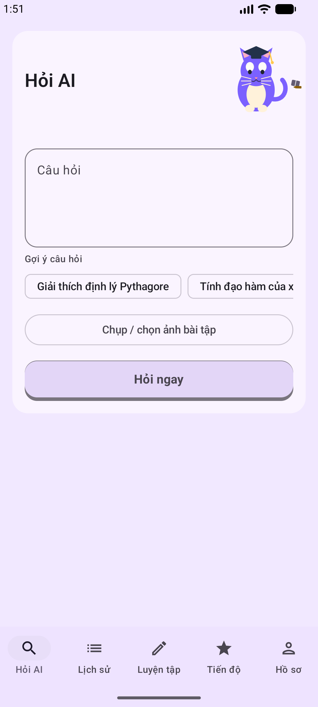
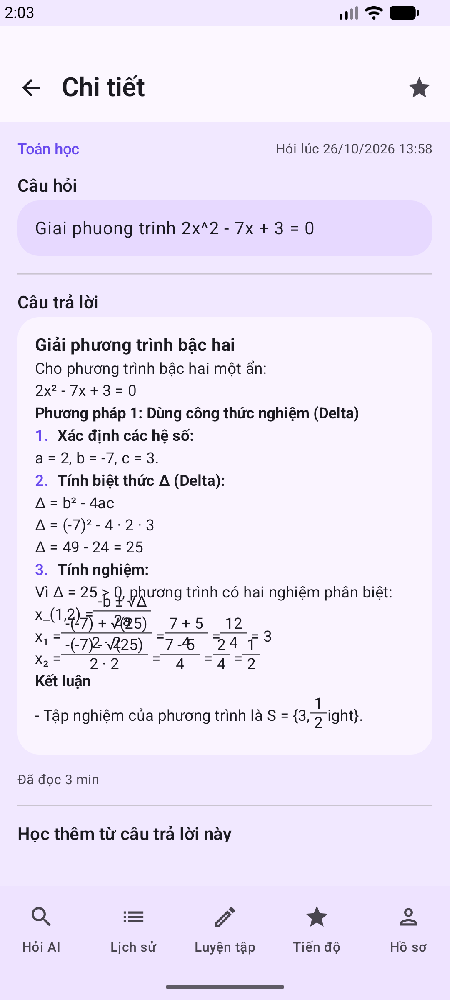
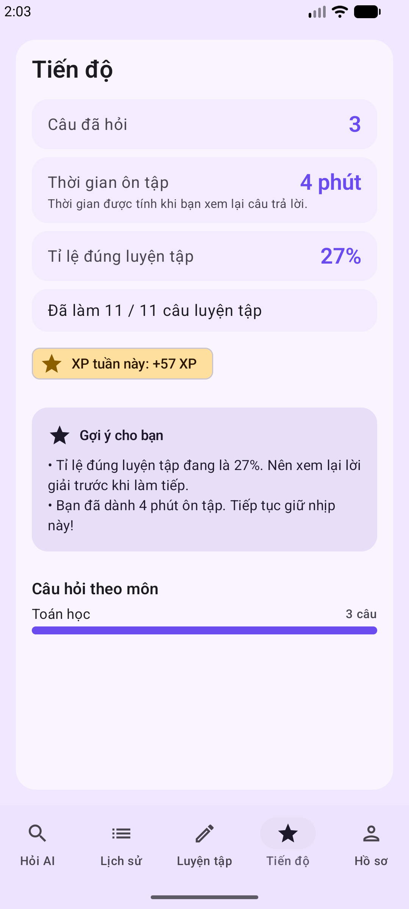

# AI Study Mentor

Ứng dụng Android giúp học sinh/sinh viên Việt Nam hỏi bài bằng **chữ hoặc ảnh**, nhận lời giải từ AI theo đúng trình độ, lưu lại lịch sử, luyện tập và theo dõi tiến độ.

> Đồ án Android — Kotlin + Jetpack Compose + Room + Gemini.

## Tính năng chính

| Nhóm | Chức năng |
|---|---|
| Hỏi AI | Nhập câu hỏi hoặc chọn ảnh bài tập; AI trả lời từng bước, tự nhận diện môn học và độ khó |
| Đọc câu trả lời | Markdown + công thức LaTeX (phân số xếp tầng, ký hiệu toán), hiệu ứng chữ hiện dần |
| Lịch sử | Tìm kiếm, lọc theo môn, đánh dấu yêu thích, hỏi lại, xoá |
| Luyện tập | Sinh câu hỏi từ bài đã hỏi; tự chọn số câu 1–20; trắc nghiệm/tự luận/điền khuyết; feedback đúng-sai + giải thích |
| Tiến độ | Thống kê câu hỏi, thời gian ôn tập, tỉ lệ đúng, XP tuần, biểu đồ theo môn và gợi ý học tập |
| Gamification | XP, cấp độ, chuỗi ngày, huy hiệu |
| Thông báo | Danh sách, đánh dấu đã đọc, xem chi tiết, mở nội dung liên quan (deep-link) |
| Hồ sơ | Đổi tuỳ chọn học tập, thông báo, đăng xuất, xoá tài khoản |
| Bảo mật | PBKDF2, EncryptedSharedPreferences, ảnh mã hoá AES-GCM, lockout 5 lần sai (bền vững qua restart) |

## Screenshots

| Hỏi AI | Câu trả lời toán | Tiến độ |
|---|---|---|
|  |  |  |

Xem thêm: [Lịch sử](docs/screenshots/02_history.png) · [Luyện tập](docs/screenshots/05_practice.png) · [Feedback](docs/screenshots/06_practice_feedback.png) · [Hồ sơ](docs/screenshots/07_profile.png) · [Onboarding](docs/screenshots/08_onboarding.png) · [Thông báo](docs/screenshots/09_notifications.png) · [Chi tiết thông báo](docs/screenshots/10_notification_detail.png)

## Kiến trúc

```
app/src/main/java/com/aistudy/aistudy/
├── domain/        # model, enum, rules thuần Kotlin (XP, similarity, insights…) — không import Android
├── data/          # Room DAO/entity, repository impl, security (PBKDF2, AES-GCM, session, throttle)
├── platform/      # ServiceLocator + ServiceGraph (DI thủ công, không Hilt/Koin)
└── ui/            # Jetpack Compose: auth, onboarding, ask, history, practice, progress, profile
```

- **UI:** Jetpack Compose + Material 3, theme tím (mascot mèo học tập) với điểm nhấn kem/vàng.
- **DI:** thủ công qua `platform/ServiceGraph.kt` (quyết định D-1).
- **AI:** `HttpURLConnection` + `org.json`, không Retrofit/OkHttp (quyết định D-5).
- **DB:** Room 7 bảng, schema JSON commit trong `app/schemas/`.
- **Offline:** app chạy được với `FakeAiClient` khi chưa có API key; dữ liệu học tập lưu local.

Chi tiết quyết định thiết kế: [`docs/PART1_M1_SOFTWARE_DESIGN.md`](docs/PART1_M1_SOFTWARE_DESIGN.md).

## Cài đặt & chạy

### Yêu cầu

- Android Studio (JBR đi kèm) + Android SDK 37
- JDK 21+ (project đang dùng JBR của Android Studio)
- Emulator hoặc thiết bị Android 13+ (minSdk 33)

### Cấu hình

Copy `AI Study/local.properties.example` → `AI Study/local.properties`:

```properties
sdk.dir=C\:\\Users\\<ban>\\AppData\\Local\\Android\\Sdk
GEMINI_API_KEY=your_key_here
GEMINI_MODEL=gemini-flash-lite-latest
```

- Không commit `local.properties`.
- Bỏ trống `GEMINI_API_KEY` → app tự dùng `FakeAiClient` để demo offline.

### Build & test

```powershell
# Build APK debug
.\build.ps1 :app:assembleDebug

# Unit test (JVM, không cần emulator)
.\build.ps1 :app:testDebugUnitTest

# Instrumented test (cần emulator/thiết bị)
.\build.ps1 :app:connectedDebugAndroidTest
```

Hoặc dùng Gradle trực tiếp trong `AI Study/`:

```bash
cd "AI Study"
./gradlew test
./gradlew assembleDebug
```

> `build.ps1` tự tạo ổ `R:` trỏ vào thư mục dự án vì AGP/gradlew không xử lý tốt đường dẫn có dấu tiếng Việt, đồng thời xếp hàng các build Gradle chạy song song.
>
> Nếu Windows báo `Address already in use: bind` khi Gradle mở daemon (cạn ephemeral port), chạy `R:\gradlew.bat -p R:\ --no-daemon :app:connectedDebugAndroidTest` hoặc `R:\gradlew.bat -p R:\ --stop` rồi thử lại.

## Test & CI

- Unit test: parser LaTeX/markdown, progress insights, XP rules, similarity, abuse filter, Gemini JSON parsing, token usage…
- Instrumented test: DAO, repository, auth lockout, smoke test cấu trúc tab.
- CI: `.github/workflows/android-test.yml` chạy `./gradlew test`.
- Kết quả vòng cải thiện gần nhất: xem [`docs/IMPROVEMENT_LOG.md`](docs/IMPROVEMENT_LOG.md).

## Tài liệu

- [`docs/ROADMAP_NEW_PHASES.md`](docs/ROADMAP_NEW_PHASES.md) — phase NP0–NP5, DoD
- [`docs/PART1_M1_SOFTWARE_DESIGN.md`](docs/PART1_M1_SOFTWARE_DESIGN.md) — quyết định D-1…D-12
- [`docs/PART1_M1_TEST_PLAN.md`](docs/PART1_M1_TEST_PLAN.md) — test plan
- [`docs/BUG_LIST_NP5.md`](docs/BUG_LIST_NP5.md) — bug list + trạng thái
- [`docs/D2_FUTURE_NP5.md`](docs/D2_FUTURE_NP5.md) — critical review / future work
- [`docs/IMPROVEMENT_LOG.md`](docs/IMPROVEMENT_LOG.md) — nhật ký cải thiện sau MVP (2026-10-26)
- [`docs/uml/`](docs/uml/) — 13 sơ đồ UML

## Ghi chú

- Đây là đồ án học tập; không có backend, dữ liệu lưu trên máy.
- Chưa hỗ trợ sync đa thiết bị, 2FA thật, leaderboard global (xem D2 future).
- "Streaming" hiện là hiệu ứng chữ hiện dần phía client; chưa phải SSE streaming từ Gemini.
